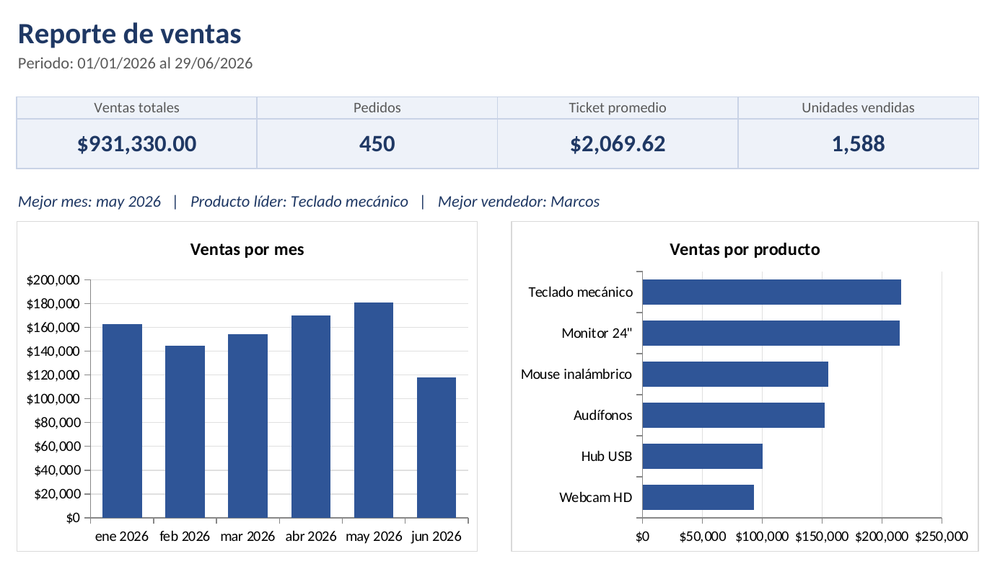

# Reporte de ventas automático en Excel

Script en Python que toma un CSV de ventas y genera un reporte en Excel con indicadores, gráficas y tablas resumen. En lugar de armar el reporte a mano cada semana, se corre un comando.

Los datos de ejemplo son inventados. Los generé yo para tener algo con qué probar.



## Qué contiene el reporte

| Hoja | Qué contiene |
| --- | --- |
| Resumen | Ventas totales, pedidos, ticket promedio, unidades, mejor mes, producto líder y mejor vendedor, con dos gráficas |
| Por mes | Ventas, unidades y pedidos por mes, y su porcentaje del total |
| Por producto | Lo mismo por producto, del que más vende al que menos |
| Por vendedor | Lo mismo por vendedor |
| Por cliente | Lo mismo por cliente |
| Datos | Las ventas originales, con filtros y encabezado fijo |

Las gráficas son gráficas reales de Excel, no imágenes: se pueden editar y se actualizan si cambian los números de las hojas "Por mes" y "Por producto".

## Cómo usarlo

```bash
pip install -r requirements.txt
python generar_ventas.py              # crea datos/ventas.csv con ventas inventadas
python reporte.py datos/ventas.csv    # crea salida/reporte_ventas.xlsx
```

Con un CSV propio: `python reporte.py mis_ventas.csv --salida salida/reporte.xlsx`.

El CSV necesita estas columnas: `fecha` (como AAAA-MM-DD), `cliente`, `producto`, `vendedor`, `cantidad`, `precio_unitario` y `total`. Si falta alguna, el script lo dice con un mensaje claro. Las filas con fecha inválida se omiten y se avisa cuántas fueron.

## Resultado con los datos de ejemplo

450 ventas de enero a junio de 2026: $931,330.00 en total, con mayo como mejor mes y el teclado mecánico como producto líder.

## Pruebas

```bash
pytest -q
```

Verifican que los totales del reporte cuadren con los datos originales, que los porcentajes sumen 100%, que las dos gráficas estén en el archivo y que los CSV mal armados den un error entendible. Probado con pandas 2.3 y pandas 3.0.

## Si tus datos vienen sucios

Este script espera datos ya ordenados. Para juntar y limpiar archivos desordenados antes de reportar, usa mi otro proyecto, `limpiador-excel`, que junta y limpia archivos de ventas.

## Herramientas

Python, pandas, XlsxWriter, openpyxl y pytest.
